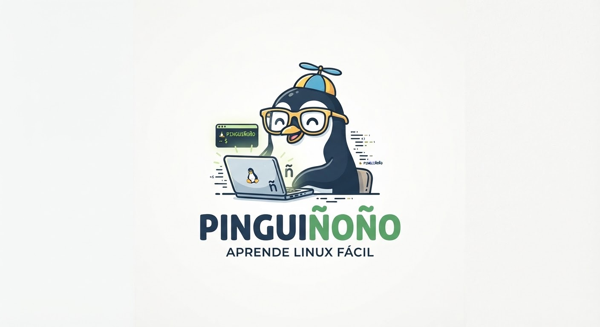

# Pinguiñoño

<p align="center">
  
</p>

<p align="center">
  <strong>Aprende Linux Fácil</strong>
</p>

<p align="center">
  Aplicación de escritorio para Linux
</p>

## Descripción

Pinguiñoño es una aplicación de escritorio nativa para Linux que te enseña Linux, Cloud y DevOps de forma interactiva. Incluye una **terminal real** conectada a tu sistema.

## Características

- **Aplicación de escritorio nativa** - Construida con Tauri (Rust + React)
- **Terminal REAL** - Ejecuta comandos reales en tu sistema Linux
- **Dashboard interactivo** con progreso, estadísticas y objetivos
- **Roadmap visual** con 16 niveles desde Fundamentos hasta Kubernetes
- **Sistema bilingüe** completo (Español/Inglés)
- **Lecciones multimodales** con texto, diagramas, ejercicios y quizzes
- **Sistema de exámenes** con bloqueo de niveles
- **Laboratorios prácticos** guiados
- **Gamificación** con XP, niveles y rachas de estudio

## Tecnologías

- **Backend**: Tauri 2 (Rust)
- **Frontend**: React 19 + TypeScript + Vite
- **Estilos**: Tailwind CSS v4
- **Estado**: Zustand (con persistencia)
- **Router**: React Router v7

## Requisitos

- Linux (Ubuntu 22.04+, Fedora 38+, o similar)
- Node.js 18+
- Rust 1.70+
- Dependencias del sistema:
  ```bash
  # Ubuntu/Debian
  sudo apt install libwebkit2gtk-4.1-dev librsvg2-dev libgtk-3-dev
  
  # Fedora
  sudo dnf install webkit2gtk4.1-devel librsvg2-devel gtk3-devel
  ```

## Instalación

```bash
# Instalar dependencias de Node
npm install

# Ejecutar en desarrollo
npm run tauri dev

# Construir para producción
npm run tauri build
```

## Estructura del Proyecto

```
├── src/                  # Frontend React
│   ├── components/       # Componentes React
│   ├── pages/           # Páginas de la app
│   ├── content/         # Contenido educativo
│   ├── stores/          # Estado global (Zustand)
│   ├── hooks/           # Custom hooks
│   ├── i18n/            # Traducciones
│   └── types/           # Tipos TypeScript
├── src-tauri/           # Backend Rust
│   ├── src/             # Código Rust
│   └── Cargo.toml       # Dependencias Rust
└── public/              # Archivos estáticos
```

## Niveles Disponibles

| Nivel | Tema | Estado |
|-------|------|--------|
| 0 | Fundamentos de Computación | ✅ 7 lecciones |
| 1 | Linux Fundamentals (1.1–1.9) | ✅ 9 lecciones |
| 2 | Administración Linux | ✅ 9 lecciones |
| 3 | Networking | ✅ 10 lecciones |
| 4 | SSH | ✅ 8 lecciones |
| 5 | Git y GitHub | ✅ 10 lecciones |
| 6 | Bash scripting | ✅ 12 lecciones |
| 7 | Docker | ✅ 12 lecciones |
| 8 | Nginx | ✅ 8 lecciones |
| 9 | PostgreSQL | ✅ 8 lecciones |
| 10 | Seguridad | ✅ 8 lecciones |
| 11 | AWS | ✅ 8 lecciones |
| 12 | CI/CD | ✅ 8 lecciones |
| 13 | DevOps | ✅ 6 lecciones |
| 14 | Terraform | ✅ 6 lecciones |
| 15 | Kubernetes | ✅ 8 lecciones |
| 16 | Nivel experto: observabilidad, secretos y DevOps avanzado | ✅ 8 lecciones |

## Documentación

- [Arquitectura](./docs/ARCHITECTURE.md)
- [Roadmap Educativo](./docs/LEARNING_ROADMAP.md)

## Licencia

Proyecto educativo personal.
